 

**Independent digital systems studio · Strategy × Product × Engineering × Intelligence**

*We don't believe in accidental growth. We design the systems behind sustainable business progress.*

[**Explore industry solutions ↗**](../docs/INDUSTRIES_AND_SERVICES.md) &nbsp; · &nbsp; [**Read our case studies ↗**](../case-studies/README.md) &nbsp; · &nbsp; [**Visit RISHEH ↗**](https://www.rishehcompany.ir)

BUSINESS-FIRST THINKING &nbsp; / &nbsp; DESIGN-LED ENGINEERING &nbsp; / &nbsp; CONNECTED OPERATIONS

---

01 / THE IDEA

## More software is not the goal. Better-connected systems are.

Businesses rarely have a shortage of tools. They struggle when their customer experience, internal operations, data, and growth efforts cannot work together.

**RISHEH** helps organizations turn those disconnected parts into coherent digital products and operational systems. We start with a business problem, find the right user experience, then engineer the architecture and integrations that allow the solution to evolve.

| UNDERSTAND | DESIGN & ENGINEER | CONNECT & IMPROVE |
|:---|:---|:---|
| Business workflows, users, constraints and priorities | Products, interfaces, APIs and maintainable architecture | Data, automations, operations and measurable iteration |

 

02 / THE INDUSTRIES

## Different businesses. Different systems.

We organize our work by **business context**, not by a generic technology catalog.

| Business environment | The system we help shape | Related evidence |
|:---|:---|:---|
| **Education & Schools** | Connected administration, academics, people and family experiences | [Hamyar School ↗](../case-studies/hamyar-school.md) |
| **Health & Specialized Services** | Trusted content, service discovery and consultation workflows | [Entekhab ↗](../case-studies/entekhab-platform.md) |
| **Commerce & Retail** | Storefronts, orders, integrations, digital fulfillment and conversion journeys | [RISHEH Pay ↗](../case-studies/risheh-pay.md) |
| **Internal Operations & CRM** | Team workspaces, business processes, project context and data views | [RISHEH Core ↗](../case-studies/risheh-core.md) |
| **AI & Automation** | Controlled agents, integrations, governed workflows and shared AI infrastructure | [AI Platform ↗](../case-studies/risheh-ai-platform.md) |
| **Career & Professional Platforms** | Structured information discovery, matching, alerts and assistance | [NHS JobBot ↗](../case-studies/nhs-jobbot.md) |
| **Real Estate & Investment** | Project discovery, structured listings and consultation journeys | [Solutions atlas ↗](../docs/INDUSTRIES_AND_SERVICES.md#real-estate-construction--investment) |
| **Legal & Professional Services** | Expertise-led experiences, intake, editorial trust and workflow follow-up | [Solutions atlas ↗](../docs/INDUSTRIES_AND_SERVICES.md#professional-legal--advisory-services) |
| **Cross-industry Web Experience** | Business-aware sites, design systems and safe generation tools | [Website Factory ↗](../case-studies/website-template-factory.md) |

**[Explore the complete industry and service atlas →](../docs/INDUSTRIES_AND_SERVICES.md)**

 

03 / SELECTED WORK

## Seven stories. Seven different system challenges.

The case studies follow the same editorial structure: **business challenge → solution direction → services applied → engineering decision → evidence**. They distinguish real source documentation from claims of production readiness or measurable client impact.

<b>01 — Hamyar School / Education systems</b>

A multi-role, multi-tenant school experience that explores the relationship between academic workflows, school operations, teachers, students and families.

**Capabilities:** Product architecture · Role-based UX · Web engineering · Data boundaries

[Read case study ↗](../case-studies/hamyar-school.md)

<b>02 — Entekhab / Specialized services</b>

Connecting educational content and expert service discovery to a clearer consultation journey in a Persian RTL experience.

**Capabilities:** UX/UI · Content architecture · Responsive web product · Intake flows

[Read case study ↗](../case-studies/entekhab-platform.md)

<b>03 — RISHEH Core / Enterprise operations</b>

A connected internal workspace designed around preserving context across conversations, tasks, knowledge and engineering work.

**Capabilities:** Operational design · Internal platforms · Workflow integration · Information architecture

[Read case study ↗](../case-studies/risheh-core.md)

<b>04 — RISHEH AI Platform / AI foundations</b>

An approach to shared AI contracts, integrations and governance boundaries without merging every product into the same execution system.

**Capabilities:** AI engineering · System design · Integration contracts · Auditable workflows

[Read case study ↗](../case-studies/risheh-ai-platform.md)

<b>05 — NHS JobBot / Career technology</b>

Structured medical job discovery and application-support workflows, bringing together source normalization, inspectable matching, alerts and assistance.

**Capabilities:** Data pipelines · Automation · Rule-based matching · AI-assisted workflows

[Read case study ↗](../case-studies/nhs-jobbot.md)

<b>06 — RISHEH Pay / Digital commerce</b>

A public engineering project built around a core commerce principle: receiving payment and fulfilling an order are different operational states.

**Capabilities:** Storefront and APIs · Transaction flows · Retry/idempotency · Security architecture

[Read case study ↗](../case-studies/risheh-pay.md) · [Public code ↗](https://github.com/mahamirmh/risheh-pay)

<b>07 — Website Template Factory / Design engineering</b>

An industry-aware generator that moves from business intent to validated site specifications, deterministic code, and safe regeneration.

**Capabilities:** UX strategy · Design systems · Next.js engineering · Developer tooling

[Read case study ↗](../case-studies/website-template-factory.md) · [Public code ↗](https://github.com/mahamirmh/Risheh-Website-Template-Factory)

**[Browse the complete case study collection →](../case-studies/README.md)**

 

04 / HOW WE HELP

## Strategy, systems and execution—together.

| Service practice | What it brings to a business |
|:---|:---|
| **Digital Products & Websites** | Corporate sites, service experiences, web applications and operational dashboards |
| **UX/UI & Product Strategy** | Discovery, journeys, information architecture, design systems and product definition |
| **AI Agents & Workflow Automation** | Purpose-bound AI assistance, integration workflows and human oversight |
| **CRM & Business Systems** | Intake, internal operations, multi-role workspaces and workflow orchestration |
| **Commerce & Growth** | Storefront experiences, transaction architecture, SEO foundations and conversion journeys |
| **Data & Intelligence** | Structured data, ingestion, analytics foundations and decision-support interfaces |

Solutions depend on the real scope and needs of each business; this is **not** a claim that every capability is live in every published project.

 

05 / PUBLIC ENGINEERING EVIDENCE

## Built in code. Explained with care.

Selected public repositories are currently hosted on founder [@mahamirmh](https://github.com/mahamirmh). We do **not** link private engineering repositories as public source.

| Open repository | What you can inspect |
|:---|:---|
| [RISHEH Industry Solutions & Corporate Profile](https://github.com/mahamirmh/RISHEH-Industry-Solutions-Corporate-Profile) | The public industry-led portfolio and bilingual company publication |
| [Website Template Factory](https://github.com/mahamirmh/Risheh-Website-Template-Factory) | Business-aware design specifications, generation and regeneration tooling |
| [RISHEH Pay](https://github.com/mahamirmh/risheh-pay) | Transaction-oriented commerce architecture and operational runbooks |
| [Universal AI Skills](https://github.com/mahamirmh/risheh-claude-skills) | Shared AI skill workflows with multi-assistant adapters |
| [Universal Downloader](https://github.com/mahamirmh/rishehdownloader) | Multi-platform download manager source and platform documentation |

**Our publishing rule:** No invented client testimonials, revenue lifts, conversion rates, deployment status, or performance claims. A repository demonstrates documented work; it does not, by itself, prove a production outcome. Some selected studies cover internal RISHEH products or solution explorations rather than paid customer projects.

 

06 / LET'S BUILD

## Start with the business problem.

Have a product to build, systems to connect, or an operational process that needs a better foundation? We approach every engagement through the same lens: **understand deeply, engineer carefully, and keep improving**.

[**RISHEH website ↗**](https://www.rishehcompany.ir) &nbsp; · &nbsp; [**Industry solutions ↗**](../docs/INDUSTRIES_AND_SERVICES.md) &nbsp; · &nbsp; [**Case studies ↗**](../case-studies/README.md)

---

**ریشه — شریک هوشمند رشد پایدار کسب‌وکار**

ما رشد تصادفی را باور نداریم. ما تجربه مشتری، محصول، داده و عملیات را به یک سیستم منسجم تبدیل می‌کنیم.

[**دریافت دفترچه فارسی ریشه ↗**](https://github.com/mahamirmh/RISHEH-Industry-Solutions-Corporate-Profile/blob/main/Risheh_Business_Sectors_FA_Ravi.pdf)

RISHEH · STRATEGY × PRODUCT × ENGINEERING × INTELLIGENCE

